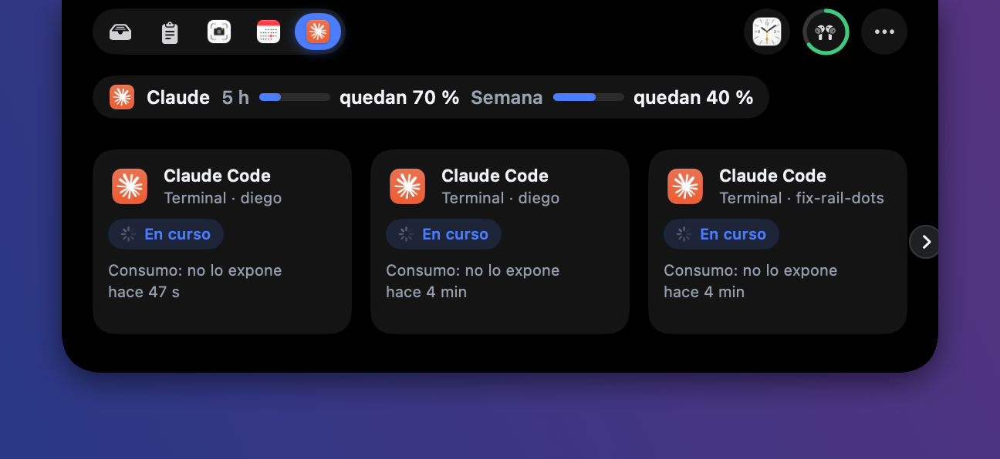
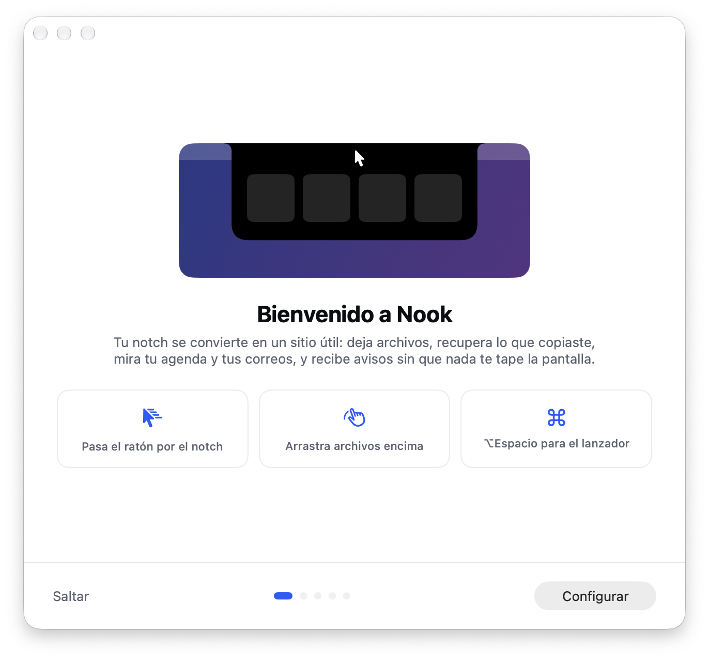
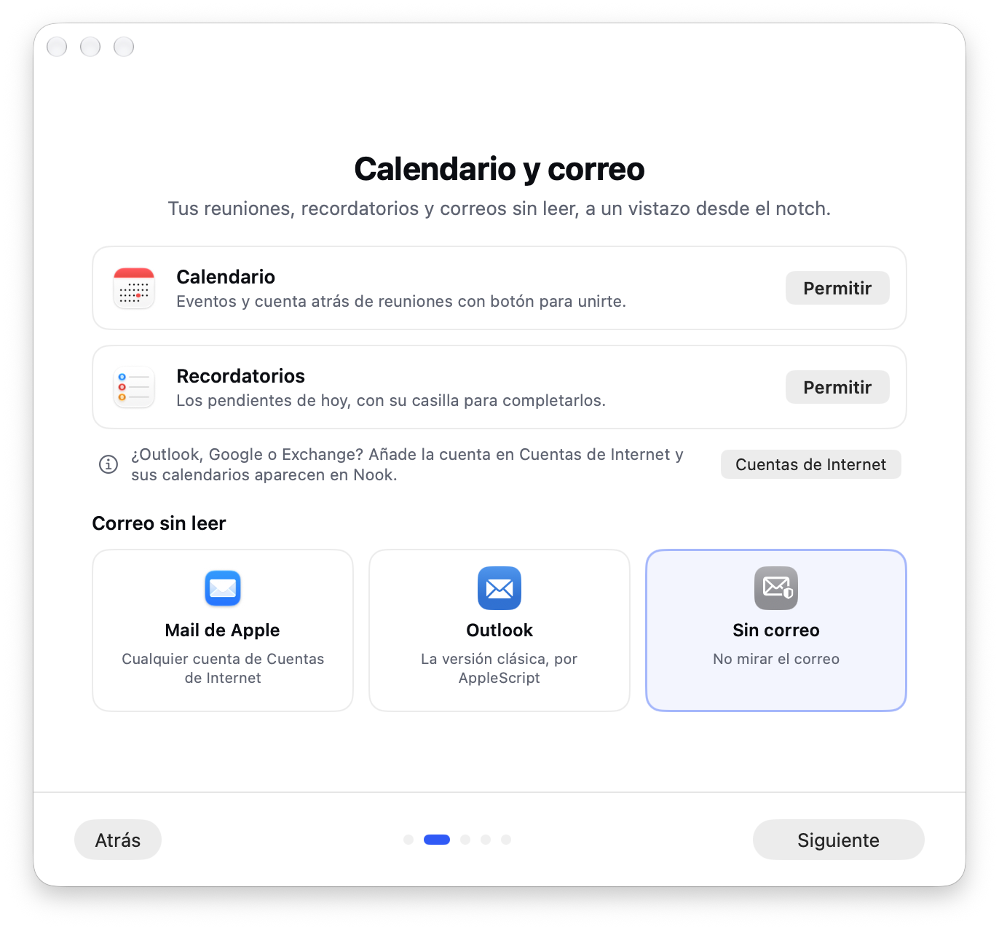
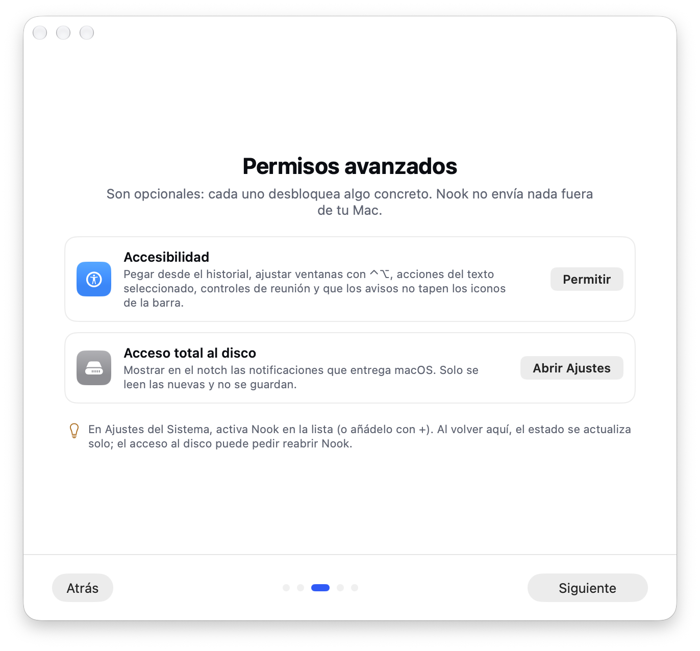
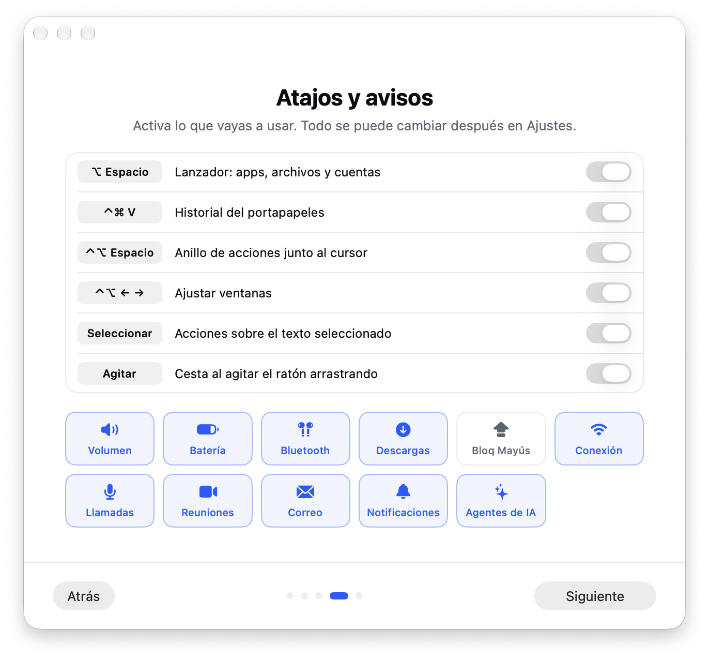

<p align="center">
  
</p>

<h1 align="center">Nook</h1>

<p align="center">
  <strong>El notch de tu Mac, convertido en un sitio útil.</strong><br>
  Pasa el ratón por arriba y tienes a mano tus archivos, lo que copiaste, tu agenda,<br>
  tu correo y tus agentes de IA. Sin ventanas, sin buscar, sin taparte nada.
</p>

<p align="center">
  
  
  
  
</p>

<p align="center">
  
</p>

---

## Deja cosas a mano

Arrastra un archivo, una imagen o un texto al notch y ahí se queda hasta que lo necesites.
Luego lo sacas arrastrando a donde quieras: un correo, un chat, una carpeta. Aunque cierres
el Mac, sigue ahí.

> ¿Arrastrando y sin llegar al notch? **Agita el ratón** y aparece una cesta flotante.

## Recupera lo que copiaste

<p align="center">
  
</p>

Todo lo que copias queda guardado: textos, enlaces, imágenes y archivos. Busca lo que
copiaste ayer (incluso el texto que hay dentro de una captura) y pégalo con
<kbd>⌃</kbd> <kbd>⌘</kbd> <kbd>V</kbd> desde cualquier app. Las contraseñas no se guardan.

## Tu día de un vistazo

- **Agenda** de hoy y los próximos días, con un botón para **unirte a la reunión** y una
  cuenta atrás en el notch cuando está a punto de empezar.
- **Recordatorios** pendientes, para tacharlos sin abrir nada.
- **Escribe y listo:** «Café con Ana mañana a las 10» crea el evento.
- **Correo:** quién te ha escrito y de qué va. Ábrelo y léelo en el propio notch, responde
  o márcalo como leído. Funciona con Mail y con Outlook.

## Tus agentes de IA, sin perderlos de vista

<p align="center">
  
</p>

Si trabajas con agentes de código, Nook te avisa **cuando uno termina o se queda esperando
tu respuesta**. Un clic en su tarjeta y estás en su terminal. Y ves cuánto te queda de la
suscripción antes de quedarte sin.

## Avisos que no estorban

Volumen, batería, AirPods conectados, descargas terminadas, reuniones, correos nuevos,
notificaciones… salen a los lados del notch un momento y se van. Nunca tapan los iconos de
la barra de menús: si no hay sitio en un lado, usan el otro.

Con tus **AirPods** puestos, verás su batería en un aro; un clic y tienes la de cada
auricular y la del estuche.

## Y unos cuantos atajos

| | |
|---|---|
| <kbd>⌥</kbd> <kbd>Espacio</kbd> | Abre apps y archivos, calcula y convierte unidades. |
| <kbd>⌃</kbd> <kbd>⌘</kbd> <kbd>V</kbd> | Historial de lo que has copiado. |
| <kbd>⌃</kbd> <kbd>⌥</kbd> <kbd>Espacio</kbd> | Anillo de acciones junto al cursor. |
| <kbd>⌃</kbd> <kbd>⌥</kbd> + flechas | Coloca la ventana a la mitad, en un cuarto, a pantalla completa… |
| Seleccionar texto | Cópialo, búscalo, tradúcelo o guárdalo con un clic. |

## Se configura solo, paso a paso

La primera vez que lo abres, Nook te acompaña: qué es, cómo conectar tu calendario y tu
correo (Apple u Outlook), qué permisos desbloquean qué y qué atajos quieres. Todo es
opcional y se puede cambiar después.

<table>
  <tr>
    <td></td>
    <td></td>
  </tr>
  <tr>
    <td></td>
    <td></td>
  </tr>
</table>

## Tu privacidad

- **Nada sale de tu Mac.** Sin cuentas, sin servidores, sin analítica.
- Del correo solo se lee lo que ves, y las imágenes remotas no se cargan hasta que lo pides.
- Puedes ocultar el panel de las capturas y grabaciones de pantalla.

## Instalar

1. Descarga el último `Nook-x.y.z.dmg` desde [Releases](../../releases/latest).
2. Arrastra Nook a **Aplicaciones** y ábrelo.

Funciona en cualquier Mac con macOS 14.2 o posterior; en los que no tienen notch aparece
como una pastilla arriba en el centro.

<details>
<summary><strong>Para desarrolladores</strong></summary>

Hecho en Swift con SwiftUI y AppKit. Hace falta Xcode 26 y
[XcodeGen](https://github.com/yonaskolb/XcodeGen).

```bash
xcodegen generate
xcodebuild -project Nook.xcodeproj -scheme Nook -derivedDataPath build/dd build
xcodebuild -project Nook.xcodeproj -scheme Nook -derivedDataPath build/dd test
```

La versión de desarrollo usa sus propios datos, así que no toca los de la app instalada.
Para distribuir: `NOTARY_PROFILE=<perfil-de-notarytool> ./scripts/release.sh`.

</details>

## Licencia

[MIT](LICENSE)
