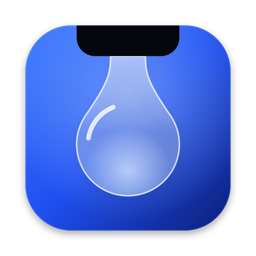
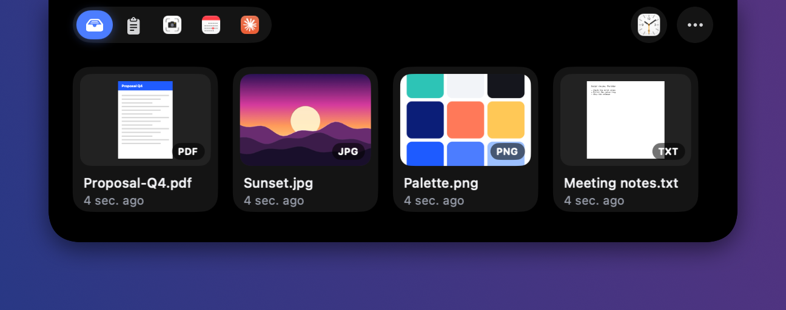
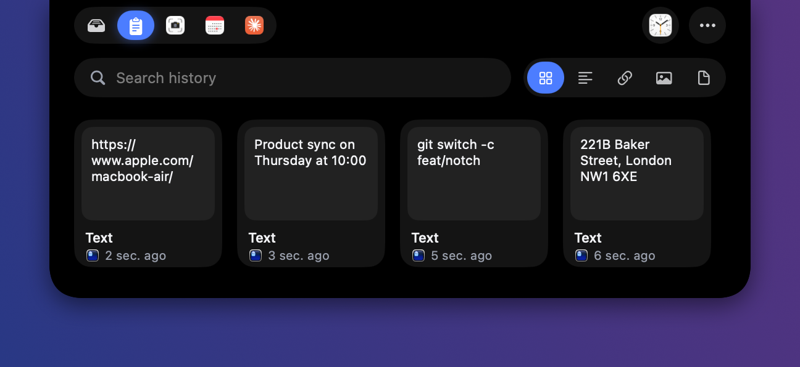
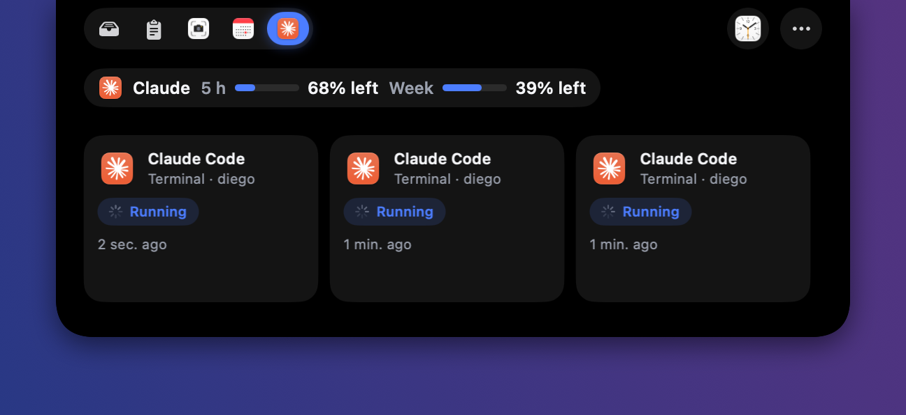
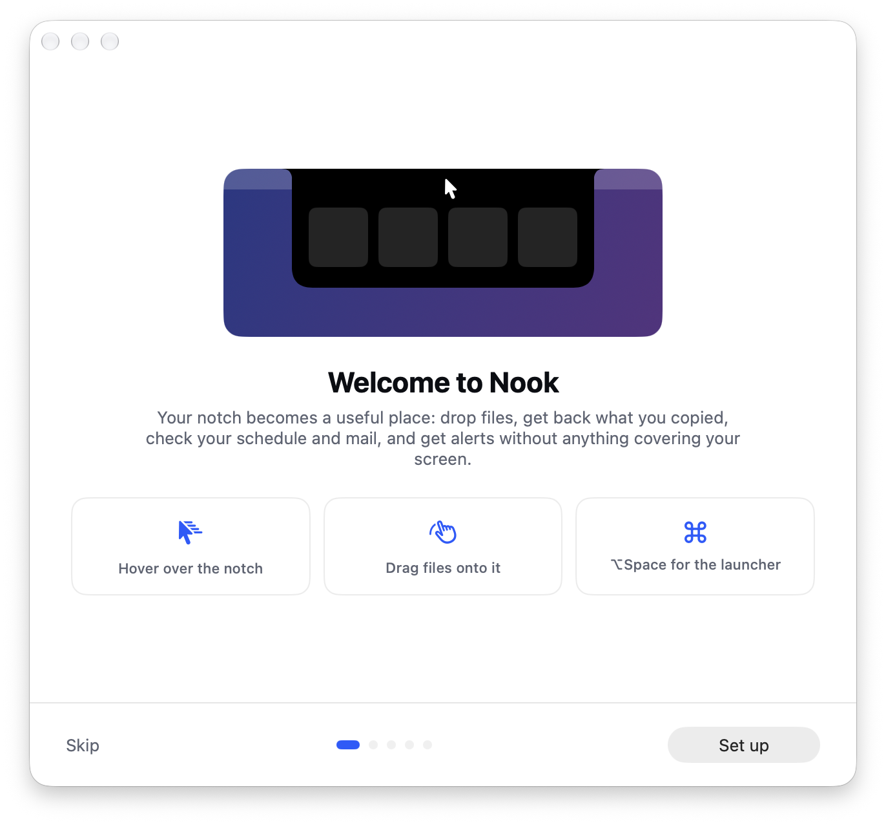
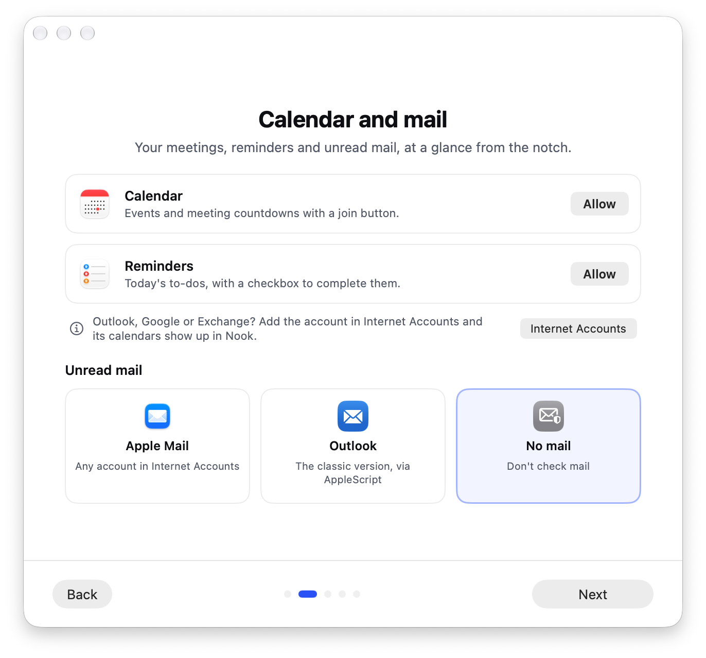
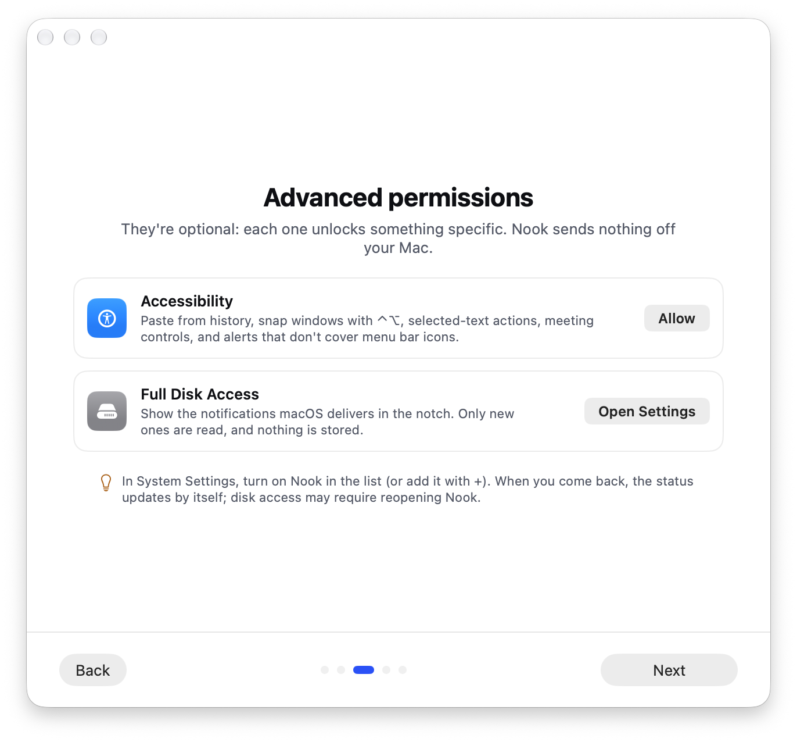
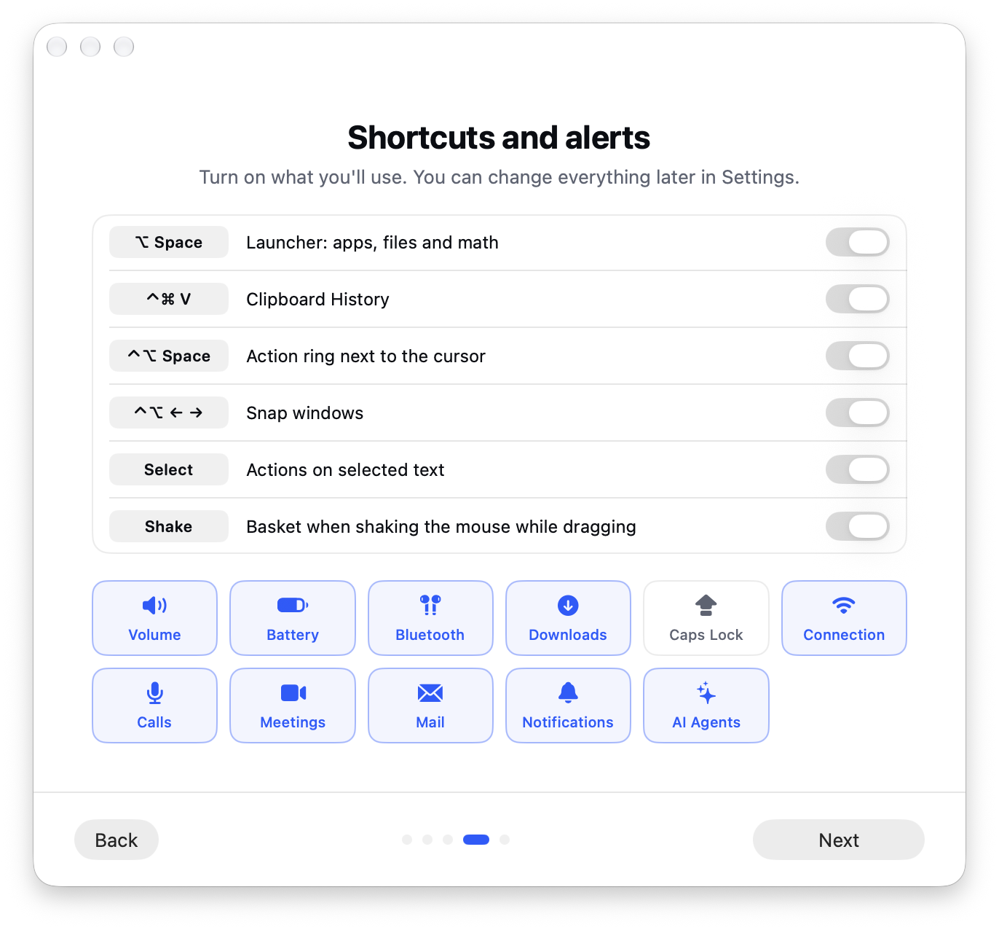

<p align="center">
  
</p>

<h1 align="center">Nook</h1>

<p align="center">
  <strong>Your Mac's notch, turned into a useful place.</strong><br>
  Move the pointer to the top of the screen and your files, everything you copied, your agenda,<br>
  your mail and your AI agents are right there. No windows, no searching, nothing covered up.
</p>

<p align="center">
  
  
  
  
</p>

<p align="center">
  
</p>

---

## Keep things at hand

Drag a file, an image or some text onto the notch and it stays there until you need it.
Then drag it out wherever you want: an email, a chat, a folder. It's still there after a
restart.

> Dragging and can't reach the notch? **Shake the mouse** and a floating basket appears.

## Get back what you copied

<p align="center">
  
</p>

Everything you copy is kept: text, links, images and files. Find what you copied yesterday
(even the text inside a screenshot) and paste it with <kbd>⌃</kbd> <kbd>⌘</kbd> <kbd>V</kbd>
from any app. Passwords are never saved.

## Your day at a glance

- **Agenda** for today and the next few days, with a button to **join the meeting** and a
  countdown in the notch when it's about to start.
- **Reminders** you haven't done yet, to check off without opening anything.
- **Just type it:** "Coffee with Ana tomorrow at 10" creates the event.
- **Mail:** who wrote to you and what it's about. Open it and read it right in the notch,
  reply or mark it as read. Works with Mail and Outlook.

## Keep an eye on your AI agents

<p align="center">
  
</p>

If you work with coding agents, Nook tells you **when one finishes or is waiting for your
answer**. Click its card and you're in its terminal. You also see how much of your
subscription is left before you run out.

## Alerts that stay out of the way

Volume, battery, AirPods connected, finished downloads, meetings, new mail, calls,
notifications… they show up beside the notch for a moment and go away. They never cover
your menu bar icons: if one side has no room, they use the other.

With your **AirPods** in, you'll see their battery as a ring; click it to see each earbud
and the case.

## And a few shortcuts

| | |
|---|---|
| <kbd>⌥</kbd> <kbd>Space</kbd> | Open apps and files, do math and convert units. |
| <kbd>⌃</kbd> <kbd>⌘</kbd> <kbd>V</kbd> | History of everything you copied. |
| <kbd>⌃</kbd> <kbd>⌥</kbd> <kbd>Space</kbd> | Action ring next to the pointer. |
| <kbd>⌃</kbd> <kbd>⌥</kbd> + arrows | Snap the window to a half, a quarter, full screen… |
| Select text | Copy it, search it, translate it or save it in one click. |

## Sets itself up, step by step

The first time you open it, Nook walks you through it: what it does, how to connect your
calendar and mail (Apple or Outlook), which permissions unlock what, and which shortcuts you
want. Everything is optional and can be changed later.

<table>
  <tr>
    <td></td>
    <td></td>
  </tr>
  <tr>
    <td></td>
    <td></td>
  </tr>
</table>

## Your privacy

- **Nothing leaves your Mac.** No accounts, no servers, no analytics.
- Only the mail you look at is read, and remote images don't load until you ask.
- You can hide the panel from screenshots and screen recordings.

## Install

1. Download the latest `Nook-x.y.z.dmg` from [Releases](../../releases/latest).
2. Drag Nook to **Applications** and open it.

Works on any Mac with macOS 14.2 or later; on Macs without a notch it shows up as a small
pill at the top center of the screen.

<details>
<summary><strong>For developers</strong></summary>

Built in Swift with SwiftUI and AppKit. Requires Xcode 26 and
[XcodeGen](https://github.com/yonaskolb/XcodeGen).

```bash
xcodegen generate
xcodebuild -project Nook.xcodeproj -scheme Nook -derivedDataPath build/dd build
xcodebuild -project Nook.xcodeproj -scheme Nook -derivedDataPath build/dd test
```

The development build uses its own data, so it never touches the installed app's.
To distribute: `NOTARY_PROFILE=<notarytool-profile> ./scripts/release.sh`.

</details>

## License

[MIT](LICENSE)
