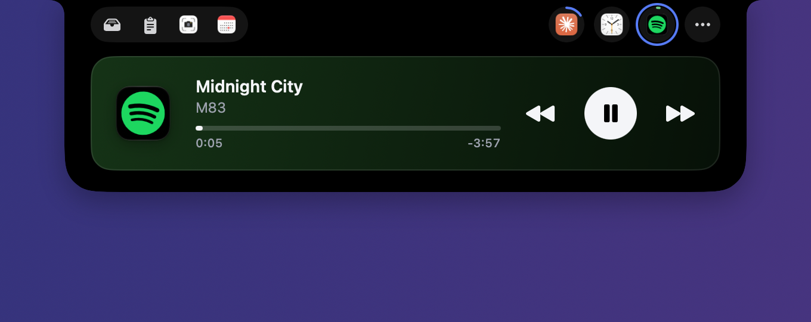
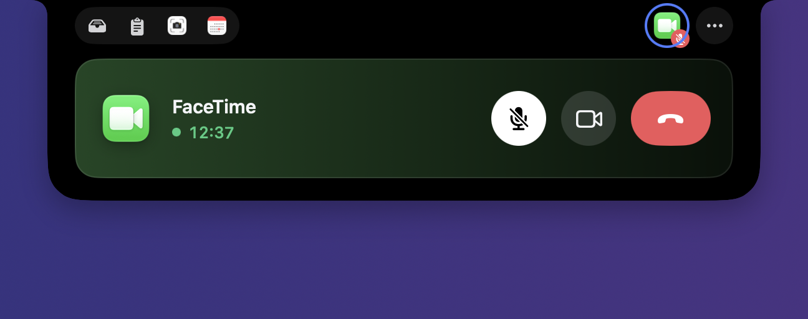
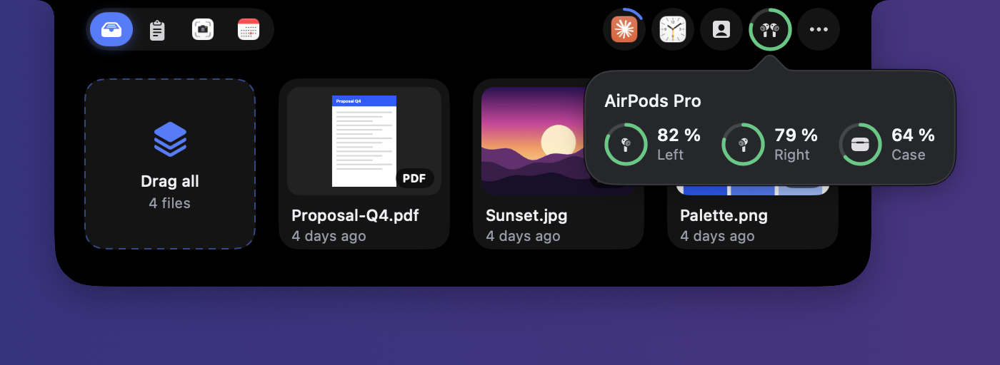
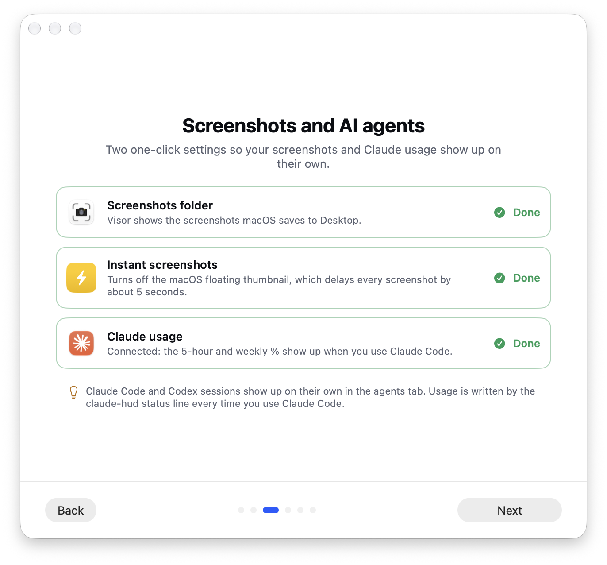

<p align="center">
  
</p>

<h1 align="center">Visor</h1>

<p align="center">
  <strong>Your Mac's notch, turned into a useful place.</strong><br>
  Move the pointer to the top of the screen and your files, everything you copied, your agenda,<br>
  your music, your calls and your AI agents are right there. No windows, no searching, nothing covered up.
</p>

<p align="center">
  
  
  
  
</p>

<p align="center">
  
</p>

---

## Keep things at hand

Drag a file, an image or some text onto the notch and it stays there until you need it.
Then drag it out wherever you want: an email, a chat, a folder. It's still there after a
restart.

> Dragging and can't reach the notch? **Shake the mouse** and a floating basket appears.

## Get back what you copied

<p align="center">
  
</p>

Everything you copy is kept: text, links, images and files. Search it, pin what you reuse
and paste it with <kbd>⌃</kbd> <kbd>⌘</kbd> <kbd>V</kbd> from any app, or pick a card with
the arrow keys and press <kbd>Return</kbd>. Passwords are never saved.

- **Copy as:** plain text, uppercase, lowercase, title case, one line or pretty JSON.
- **QR code** of any text or link, to open it on your phone.
- **Text from an image or a screenshot**, recognized on your Mac.

## Your day at a glance

- **Agenda** for today and the next few days, with a button to **join the meeting** and a
  countdown in the notch when it's about to start. Events that already ended disappear, and
  when the day changes it jumps to today.
- **Reminders** you haven't done yet, to check off without opening anything.
- **Just type it:** "Coffee with Ana tomorrow at 10" creates the event.
- **Mail:** your latest messages, read and unread. Open one, read it and **reply** right in
  the notch, or mark it as read. Choose which senders get an alert. Works with Mail and the
  classic Outlook.

## Your music, one click away

<p align="center">
  
</p>

While Spotify or Music is playing, its logo shows up in the notch with a ring for the song's
progress. Move the pointer to the notch and the player is already open: the artwork, the time
left and previous, play/pause and next. When nothing else needs your attention, the closed
notch shows what's playing.

## Calls without hunting for the window

<p align="center">
  
</p>

In a call on Teams, Zoom, Meet, FaceTime or Discord, move the pointer to the notch and the
call is right there: the app's icon, how long you've been talking and big **mute, camera and
hang up** buttons, without leaving what you're doing. In apps that say so (Teams, Zoom, Meet),
the buttons show whether you're really muted, even if you muted from the app itself. A red
badge reminds you when you're muted, and the meeting reminder goes away as soon as you join.

## AirPods and screenshots

<p align="center">
  
</p>

- **AirPods battery** for each earbud and the case, from the moment you connect them, with the
  icon of your exact model, AirPods Pro 3 included.
- **Screenshots in their own folder:** Visor moves them off the Desktop to
  *Pictures/Screenshots* (or uses the folder you already had) and shows the latest ones in the
  notch, ready to drag.

## Keep an eye on your AI agents

<p align="center">
  
</p>

If you work with Claude Code or Codex, Visor tells you **when an agent finishes or is waiting
for your answer**. Click its card and you're in its terminal or VS Code. You also see **how much
of your Claude plan you've used** in the 5-hour and weekly windows, and **when each one
resets**, with an alert at 80 % and 95 %.

## Alerts that stay out of the way

Volume, battery, AirPods, finished downloads, meetings, new mail, agents, Focus,
notifications… they show up beside the notch for a moment and go away. They never cover
your menu bar icons: if there's no room beside the notch, the alert grows below it as a small
island, sized to its text. Numbers turn over smoothly, the timer ring runs continuously and
long text, like a dictation, fades out at the start instead of being cut.

**Click an alert** and the notch opens a little to show a preview, with a button to go
straight to the mail, the session, the download or the meeting.

## A clock in the notch

A timer you set with hours, minutes and seconds wheels, your recent durations a click away,
alarms and *keep awake*, laid out like the Clock app. The time left shows as a ring around the
button.

## And a few shortcuts

| | |
|---|---|
| <kbd>⌥</kbd> <kbd>Space</kbd> | Open apps and files, do math and convert units. |
| <kbd>⌃</kbd> <kbd>⌘</kbd> <kbd>V</kbd> | History of everything you copied. |
| <kbd>⌘</kbd> <kbd>1</kbd> … <kbd>6</kbd> | Switch tabs while the panel is open. |
| <kbd>⌃</kbd> <kbd>⌥</kbd> <kbd>Space</kbd> | Action ring next to the pointer. |
| <kbd>⌃</kbd> <kbd>⌥</kbd> + arrows | Snap the window to a half, a quarter, full screen… |
| Select text | Copy it, search it, translate it or save it in one click. |
| ⋯ menu > Eyedropper | Copy the color of any pixel as HEX. |

## Sets itself up, step by step

The first time you open it, Visor walks you through it: what it does, how to connect your
calendar and mail, where your screenshots are, how to see your Claude usage, which
permissions unlock what, and which shortcuts you want. Everything is optional and can be
changed later.

<table>
  <tr>
    <td></td>
    <td></td>
  </tr>
  <tr>
    <td></td>
    <td></td>
  </tr>
</table>

## Your privacy

- **Nothing leaves your Mac.** No accounts, no servers, no analytics.
- Only the mail you look at is read, and remote images don't load until you ask.
- You can hide the panel from screenshots and screen recordings.

## Install

1. Download the latest `Visor-x.y.z.dmg` from [Releases](../../releases/latest).
2. Drag Visor to **Applications** and open it.

Works on any Mac with macOS 14.2 or later; on Macs without a notch it shows up as a small
pill at the top center of the screen.

> **Coming from Nook?** Visor is the same app with a new name. It keeps your shelf, history
> and settings. macOS asks for the permissions again because it's a new app, and you can
> delete Nook afterwards.

<details>
<summary><strong>For developers</strong></summary>

Built in Swift with SwiftUI and AppKit. Requires Xcode 26 and
[XcodeGen](https://github.com/yonaskolb/XcodeGen).

```bash
xcodegen generate
xcodebuild -project Nook.xcodeproj -scheme Nook -derivedDataPath build/dd \
  -allowProvisioningUpdates -allowProvisioningDeviceRegistration build
xcodebuild -project Nook.xcodeproj -scheme Nook -derivedDataPath build/dd test
```

The project and module are still called `Nook` inside; the app is `Visor.app`. Sign with
your own team: the Focus alert needs a paid developer account and a registered Mac. The
development build uses its own data, so it never touches the installed app's.

To distribute: `NOTARY_PROFILE=<notarytool-profile> ./scripts/release.sh`. Add
`DEVELOPER_ID_PROFILE=<path>` with a Developer ID profile that includes Communication
Notifications to keep the Focus alert; without it, the release ships without that alert.

</details>

## License

[MIT](LICENSE). The continuous corners of the notch and some spring values are adapted from
[islandcn](https://github.com/opencoredev/islandcn) (MIT); see
[THIRD_PARTY_NOTICES](THIRD_PARTY_NOTICES.md).
