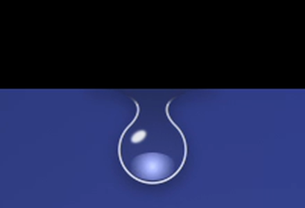
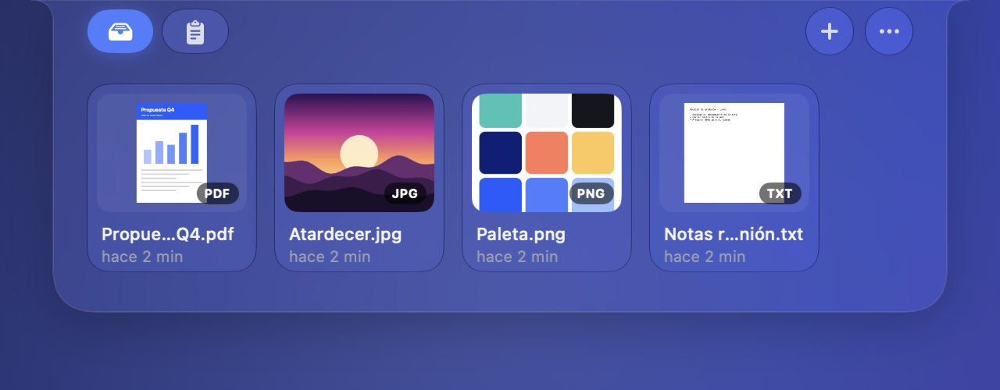
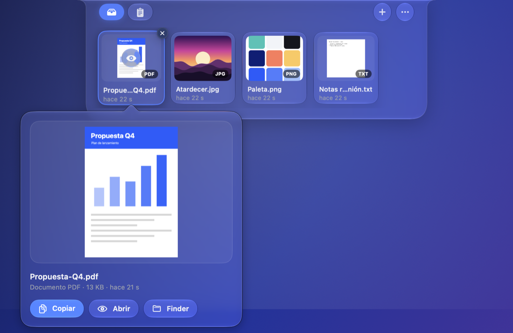
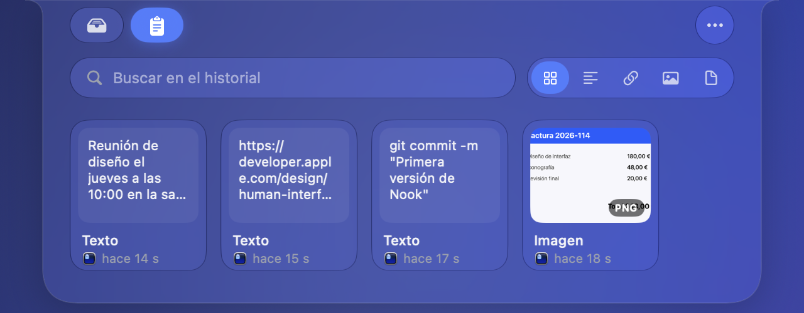

<p align="center">
  
</p>

<h1 align="center">Nook</h1>

<p align="center">
  <strong>Una bandeja y un historial del portapapeles que viven en el notch de tu Mac.</strong><br>
  Deja ahí lo que vas a necesitar luego y sácalo arrastrando cuando toque.
</p>

<p align="center">
  
  
  
  
</p>

<p align="center">
  
</p>

---

## Sale del notch

Acerca el ratón al notch y aparece una gota de agua de cristal colgando de él: refracta lo
que hay detrás, tiene su reflejo y concentra la luz abajo, como una gota de verdad. Al entrar,
el panel sale del propio notch, hacia abajo y a los lados a la vez, y el negro se disuelve en
Liquid Glass. Todo es cristal: el panel, las pestañas, los botones y las tarjetas.

<p align="center">
  
</p>

## Bandeja

Arrastra archivos, imágenes o texto al notch y se quedan a mano, con su vista previa real,
hasta que los saques. Nook guarda una copia, así que siguen ahí aunque muevas o borres el
original, cierres la app o apagues el Mac.

<p align="center">
  
</p>

**Sin arrastrar, también:** el botón <code>+</code> abre el selector de archivos, y en Finder
tienes <em>clic derecho &gt; Servicios &gt; Añadir a Nook</em>.

### Vista previa grande

¿Dos PDF que se llaman casi igual? Pasa el ratón por una tarjeta y pulsa el ojo (o haz doble
clic): se abre una vista grande con el tipo y el tamaño. Desde ahí la arrastras a cualquier
app, la copias, la abres con Vista Rápida o la muestras en Finder.

<p align="center">
  
</p>

## Historial del portapapeles

Todo lo que copias queda guardado: texto, enlaces, imágenes y archivos, con el icono de la
app de la que salió. Filtra por tipo, busca y fija lo que no quieras perder.

<p align="center">
  
</p>

- **Busca dentro de las imágenes.** El texto de capturas y fotos se reconoce en el propio Mac
  (Vision), así que buscar "factura" encuentra la imagen de la factura.
- **<kbd>⌃</kbd> <kbd>⌘</kbd> <kbd>V</kbd> desde cualquier app** abre el historial con el
  buscador listo; <kbd>↩</kbd> copia el primer resultado y vuelves a donde estabas para pegar.
- **Sin contadores corriendo.** Cada tarjeta dice cuándo llegó: "hace 20 s" durante el primer
  minuto y después "hace 5 min", "hace 2 h"...
- **Nunca se borra solo.** No hay límite por defecto, y vaciar la bandeja o borrar el historial
  pide confirmación.
- **Respeta lo privado.** Lo que los gestores de contraseñas marcan como confidencial no se guarda.

## Todo lo demás

| | |
|---|---|
| **Vista previa** | Doble clic abre Quick Look; las tarjetas muestran páginas de PDF, fotos y documentos reales. |
| **Compartir** | AirDrop, Mensajes o Mail desde el menú de cada tarjeta, y "Mostrar en Finder". |
| **Copiar texto de una imagen** | OCR local, nada sale del Mac. |
| **Comprimir y convertir** | Crea un `.zip` o convierte imágenes a PNG, JPEG o HEIC. |
| **Copiar bien en cualquier app** | Las imágenes y los PDF se copian como archivo y como contenido, así se pegan tanto en Finder como en un chat. |
| **Fuera de las capturas** | El panel no aparece en capturas ni grabaciones de pantalla (se puede desactivar). |
| **Sin notch** | En pantallas sin notch aparece una pastilla arriba en el centro. |
| **Claro y oscuro, ES y EN** | Y con "Reducir movimiento" las animaciones se simplifican. |

## Permisos

Ninguno especial: no pide Accesibilidad ni Grabación de pantalla y funciona en sandbox.
Desde macOS 15.4 el sistema puede preguntar por **"Pegar desde otras apps"**; si el acceso
queda en "Preguntar" o "Denegar", el historial se pausa y Nook explica cómo permitirlo.

## Compilar

Requisitos: Xcode 26 o posterior y [XcodeGen](https://github.com/yonaskolb/XcodeGen). macOS 14+.

```bash
xcodegen generate
xcodebuild -project Nook.xcodeproj -scheme Nook -derivedDataPath build/dd build
xcodebuild -project Nook.xcodeproj -scheme Nook -derivedDataPath build/dd test
```

La build Debug usa su propio identificador (`com.diegoperez.nook.debug`), así que probarla
no toca la bandeja ni el historial de la app instalada. Argumentos solo de Debug:

- `-NookOpen shelf|clipboard` abre el panel al arrancar y lo deja abierto.
- `-NookReset YES` vacía la bandeja y el historial de la build Debug.
- `-hideFromCaptures NO` deja ver el panel en capturas.

## Distribución

```bash
./scripts/release.sh                                  # DMG firmado con Developer ID
NOTARY_PROFILE=keyfold-notary ./scripts/release.sh    # además notarizado y grapado
```

El DMG queda en `dist/`. El icono se genera con `swift scripts/make-icon.swift Nook/Resources/Assets.xcassets/AppIcon.appiconset`.
